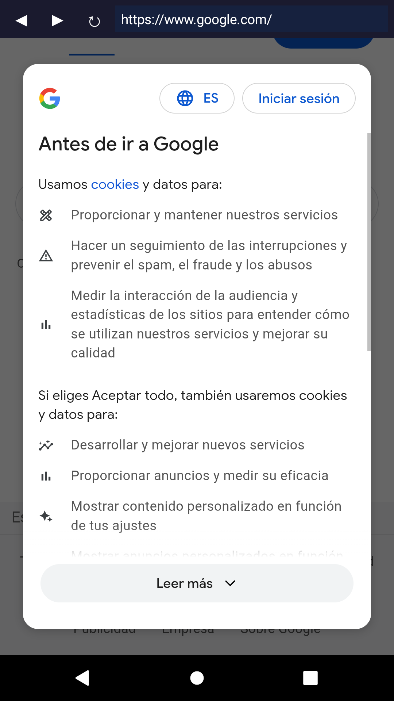
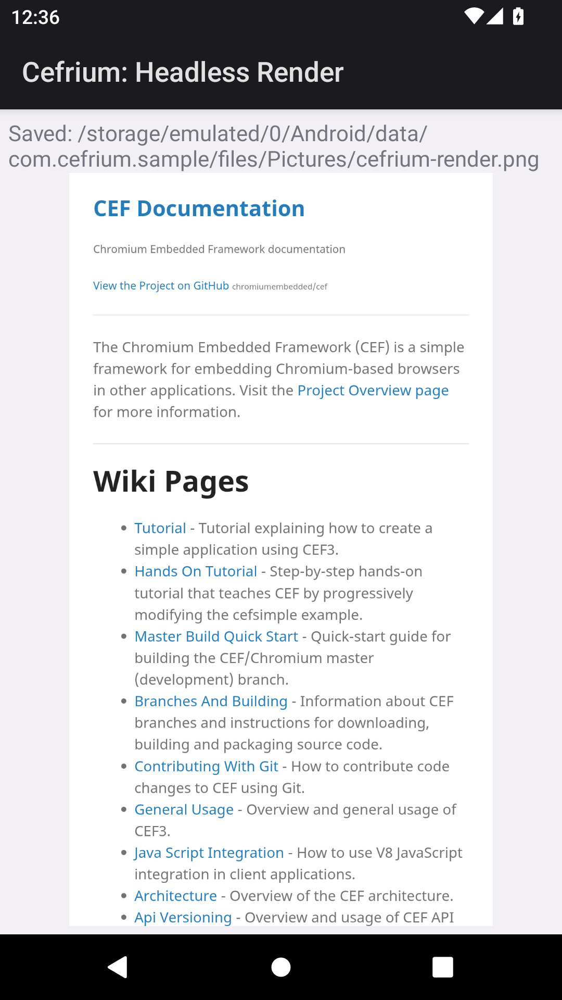

# Cefrium — CEF for Android

The first working port of [Chromium Embedded Framework](https://github.com/chromiumembedded/cef)
to native Android (`aarch64-linux-android`, bionic libc, Android NDK).

CEF officially supports Windows, Linux, and macOS. Android has long been
considered out of scope due to its fundamentally different process model
and UI stack. This project builds on CEF's solid foundation to close
that gap.




*Left: Cefrium Browser with URL bar, navigation, video+audio. Right: Headless render — URL to PNG via OSR mode.*

> **App size.** Cefrium bundles the Chromium engine, so it adds ~150 MB of native
> code per ABI to your app. The dependency AAR is multi-ABI (~240 MB); publish an
> **Android App Bundle** (or use ABI splits / `ndk.abiFilters`) so each user
> downloads only their architecture (~150 MB), not all ABIs — the same approach
> GeckoView, Flutter, and other engine-bundling SDKs use.

**[Quick Start](QUICKSTART.md)** · [API Docs](https://cefrium.com/docs) · [Migration from WebView](MIGRATION.md) · [Build from Source](BUILD-GUIDE.md) · [Samples](https://codeberg.org/cefrium/cefrium-sample)

## What works

| Feature | Status |
|---------|--------|
| `libcef.so` links for Android arm64 and x86_64 | Done |
| `CefInitialize` + `CreateBrowser` | Done |
| OnPaint off-screen rendering (pixel buffer) | Done |
| On-screen rendering (Bitmap + ImageView) | Done |
| Touch, scroll, pinch-zoom | Done |
| Multi-process (renderer as Android Service) | Done |
| `is_official_build=true` (LTO + R8) | Done |
| CEF C API fully available | Done |
| SDK AAR for Gradle integration | Done |
| Web Speech API (text-to-speech) | Done |
| Scroll-driven CSS animations | Done |
| Mobile viewport (device scale factor) | Done |
| Ad blocking (network-level request interception) | Done |
| User-Agent: Chrome/148 Cefrium/1.0 | Done |
| H.264/AAC video (proprietary codecs build) | Done |
| **Video playback (Surface rendering)** | **Done** |
| **Audio output** | **Done** |
| Surface rendering via ContentViewRenderView | Done |
| Context menu (long press — CEF API) | Done |
| Find in page (CefBrowserHost::Find) | Done |
| File dialog (`<input type=file>`) | Done |
| Downloads (CefDownloadHandler) | Done |
| Dark mode (CefRequestContext::SetChromeColorScheme) | Done |
| Unified Callback interface | Done |
| Lifecycle pause/resume | Done |
| Jetpack Compose wrapper (CefriumWebView) | Done |
| Idiomatic Compose API (CefriumView / state hoisting + keep-alive) | Done |
| evaluateJavaScript (CefFrame::ExecuteJavaScript) | Done |
| JavaScript ↔ native bridge (window.cefriumQuery, CefMessageRouter) | Done |
| Cookie management (CefCookieManager: get/set/delete/flush) | Done |
| Dynamic WebSettings (runtime User-Agent, JavaScript on/off, zoom) | Done |
| Navigation: loadHtml / postUrl / stopLoading | Done |
| Request interceptor (programmatic block, CefResourceRequestHandler) | Done |
| JS dialogs (alert / confirm / prompt, CefJSDialogHandler) | Done |
| Popups (window.open / target=_blank, OnBeforePopup) | Done |
| Cache control (clearCache) | Done |
| arm64 + x86_64 validated on device + emulator (30 instrumented tests) | Done |
| Published on Codeberg Packages (Maven) | Done |
| Android Accessibility (TalkBack) | Done |
| Android Autofill (Proton Pass, Google) | Done |
| Widevine DRM (Netflix, Disney+, Spotify) | Done |

## Why Cefrium, not WebView?

Android WebView runs on whatever Chromium version the device has — which
may be outdated, broken by manufacturer customization, or missing features
your app depends on. Cefrium solves three problems that WebView cannot:

**1. Version consistency.** Cefrium pins to a specific Chromium version
(currently 148). Your web code runs identically on every device, regardless
of the system WebView version. No more "works on Pixel, breaks on Samsung."

**2. Full network control.** WebView's `shouldInterceptRequest` is limited
to URL matching. Cefrium inherits CEF's `CefRequestHandler` which gives
full access to headers, POST bodies, redirects, and response modification —
enabling native ad blocking, request rewriting, and custom protocol handlers
without JavaScript injection.

**3. Off-screen rendering.** Need to render HTML to a pixel buffer for
screenshots, PDF generation, or headless processing? WebView has no API
for this. Cefrium's `OnPaint` delivers BGRA frames to your code — no
Activity, no UI, no Surface required.

| Capability | Cefrium | Android WebView |
|------------|---------|-----------------|
| Chromium version control | Pinned (148) | Varies by device |
| Off-screen rendering (pixel buffer) | Yes (OnPaint) | No |
| Network-level ad blocking | Yes (CefRequestHandler) | Limited (shouldInterceptRequest) |
| Multi-process control | Yes | No |
| Request headers/body access | Full | URL only |
| Custom protocol handlers | Yes (CefSchemeHandlerFactory) | Partial |
| DRM (Widevine) | Yes | Yes |
| Autofill (password managers) | Yes | Yes |
| Accessibility (TalkBack) | Yes | Yes |

### What is CEF?

[CEF](https://github.com/chromiumembedded/cef) (Chromium Embedded Framework)
is a BSD-licensed framework maintained by Marshall Greenblatt since 2008.
Over 100 million installed instances power products from Steam, Spotify,
Discord, OBS, and hundreds of other applications across Windows, Linux,
and macOS. Cefrium extends CEF to the one major platform it was missing:
Android.

## Architecture

- **Off-screen rendering** via `CefRenderHandler::OnPaint` — no Views
  framework, no X11, no Wayland
- **Multi-process** with renderer running as an Android `Service`,
  replacing Unix `fork()`/`execve()`
- **16 Android-specific Chromium patches** for Android adaptations, managed via
  CEF's existing patch infrastructure (`cef/patch/patches/android/`)
- **Gradle Plugin** generates R.java for Chromium packages in consumer
  projects, solving the multi-package resource ID problem

## Building from source

Prerequisites: Chromium source tree at tag `148.0.7778.167`, ~400 GB disk,
64 GB RAM.

```bash
# 1. Apply CEF patches (including Android-specific). The Android patches are
#    gated on an env var whose NAME is the literal condition string; set it for
#    the patcher process with `env` (it can't be a normal `export`, since the
#    name contains '=' and '"').
cd chromium/src
env 'target_os=="android"=1' python3 cef/tools/patcher.py

# 2. Generate build files
depot_tools/gn gen out/Official_android_arm64 --args='
  target_os = "android"
  target_cpu = "arm64"
  is_official_build = true
  is_debug = false
  is_component_build = false
  android_non_final_r_java = true
  proprietary_codecs = true
  ffmpeg_branding = "Chrome"
'
# Omit proprietary_codecs and ffmpeg_branding for the libre variant.

# 3. Build test APK (standalone, all-in-one — for validation)
ninja -C out/Official_android_arm64 cef/tests/cef_android_test:cefrium_test_apk

# 4. Build SDK AAR (for Gradle consumers)
ninja -C out/Official_android_arm64 cef/cefrium_sdk:cefrium_sdk
```

## Running the test APK

The test APK is a standalone app that bundles everything — useful for
validating that CEF works on a device/emulator before packaging as AAR.

```bash
# Start emulator
third_party/android_sdk/public/emulator/emulator -avd cefrium_x64 &

# Wait for boot, install, launch
adb wait-for-device
adb install out/Official_android_x64/apks/CefriumTest.apk
adb shell am start -n org.cefrium.test/.CefriumTestActivity

# Check logs
adb logcat -s "chromium:*" "CefriumTest:*"
```

## SDK releases

Pre-built AARs are published on
**[Codeberg Packages](https://codeberg.org/cefrium/-/packages)**
(Maven registry). No need to build from source.

### Gradle integration

Add the Cefrium Maven repository to your project:

```groovy
// settings.gradle
pluginManagement {
    repositories {
        maven { url 'https://codeberg.org/api/packages/cefrium/maven' }
        google()
        mavenCentral()
    }
}
dependencyResolutionManagement {
    repositories {
        google()
        mavenCentral()
        maven { url 'https://codeberg.org/api/packages/cefrium/maven' }
    }
}
```

```groovy
// app/build.gradle
plugins {
    id 'com.android.application'
    id 'com.cefrium' version '0.2.1'  // Generates R.java for Chromium packages
}

dependencies {
    // Cefrium SDK from Codeberg Packages — single multi-ABI artifact
    // (arm64-v8a + x86_64); your APK/App Bundle ships only the device's ABI.
    implementation 'com.cefrium:cefrium-sdk:0.2.1'

    // Optional: Jetpack Compose wrapper
    implementation 'com.cefrium:cefrium-compose:0.2.1'

    // Required runtime dependencies
    implementation 'androidx.appcompat:appcompat:1.7.0'
    implementation 'androidx.mediarouter:mediarouter:1.7.0'
    implementation 'androidx.core:core:1.16.0'
    implementation 'androidx.browser:browser:1.8.0'
}
```

(App size: see the note at the top and [APK size optimization](#apk-size-optimization).)

### Direct download

Alternatively, download the AAR directly from
[Codeberg Packages](https://codeberg.org/cefrium/-/packages):

**SDK (multi-ABI: arm64-v8a + x86_64, H.264/AAC + VP8/VP9/Opus):**
- [cefrium-sdk-0.2.1.aar](https://codeberg.org/api/packages/cefrium/maven/com/cefrium/cefrium-sdk/0.2.1/cefrium-sdk-0.2.1.aar) (~240 MB; the consumer's APK/App Bundle ships only the device's ABI, ~150 MB)

**Jetpack Compose wrapper (all architectures):**
- [cefrium-compose-0.2.1.aar](https://codeberg.org/api/packages/cefrium/maven/com/cefrium/cefrium-compose/0.2.1/cefrium-compose-0.2.1.aar) (28 KB)

Place in `app/libs/` and use `implementation files('libs/cefrium-sdk.aar')`.

### Variants

Each artifact is a single **multi-ABI** AAR (arm64-v8a + x86_64; only the device's
ABI is shipped per APK/App Bundle). They differ only by codec policy:

| Artifact | Codecs | Use case |
|----------|--------|----------|
| `cefrium-sdk` | H.264, H.265, AAC, VP8, VP9, Opus | Full site compatibility (published) |
| `cefrium-sdk-libre` | VP8, VP9, Opus, Vorbis | Royalty-free only (planned) |

**Patent note:** H.264 patents expire by [November 2027](https://www.osnews.com/story/24954/us-patent-expiration-for-mp3-mpeg-2-h264/)
(last US patent: [US 7826532](https://patents.google.com/patent/US7826532B2), expires 2027-11-29).
In the EU, software "as such" is excluded from patentability
([EPC Art. 52](https://en.wikipedia.org/wiki/Software_patents_under_the_European_Patent_Convention)).

See [cefrium-sample](https://codeberg.org/cefrium/cefrium-sample) for
complete working examples.

### Publishing (maintainers)

Releases are pushed to the Codeberg Maven registry with
`cef/cefrium_sdk/publish-maven.sh <version>` (token at `~/.registry-token`,
package scope). It uploads the SDK variants, `cefrium-compose`, and the Gradle
plugin. Versions are immutable — bump the version to publish changes; existing
artifacts return 409 and are skipped. Full steps in
[BUILD-GUIDE.md](BUILD-GUIDE.md) §7.

### APK size optimization

The SDK AAR is multi-ABI (~240 MB, both `arm64-v8a` and `x86_64`). Each consumer
APK/App Bundle ships only one ABI, so the per-architecture footprint is ~150 MB.
The final APK size then depends on your app's configuration. To minimize it:

```groovy
// app/build.gradle
android {
    buildTypes {
        release {
            minifyEnabled true
            shrinkResources true
            proguardFiles getDefaultProguardFile('proguard-android-optimize.txt'),
                          'proguard-rules.pro'
        }
    }

    // Ship only the architecture your users need
    splits {
        abi {
            enable true
            reset()
            include 'arm64-v8a'  // or 'x86_64' for emulator-only
            universalApk false
        }
    }
}
```

R8/ProGuard automatically strips unused Java classes from the final APK.
Cefrium's `proguard.txt` includes the necessary keep rules for Chromium's
JNI and reflection usage.

| Configuration | Approximate APK size |
|--------------|---------------------|
| Debug (single arch) | ~250 MB |
| Release + R8 (single arch) | ~150 MB |
| Release + R8 + ABI split | ~150 MB per arch |
| AAB (Play Store) | ~100 MB download |

For smallest download size, use Android App Bundle (AAB) format which
delivers only the needed architecture to each device.

## Project structure

```
cef/
├── libcef/browser/android/        # Android browser implementation
├── cefrium_sdk/                   # AAR packaging (BUILD.gn, slim_aar.py)
│   ├── gradle-plugin/             # Gradle Plugin for R class generation
│   └── java/src/com/cefrium/      # Java API
├── cefrium_compose/               # Jetpack Compose wrapper (cefrium-compose.aar)
├── cefrium_instrumentation_test/  # On-device instrumented test harness (SDK + Compose)
├── tests/cef_android_test/        # Test APK
└── patch/patches/android/         # 16 Android-specific Chromium patches
```

## Testing

`cefrium_instrumentation_test/` is the authoritative on-device test harness for
the SDK — a self-contained Gradle module (consumes the built AARs) so a clone of
this repo is self-verifying, independent of the samples repo. It covers the Java
SDK (core, hardening, the `window.cefriumQuery` JS bridge) and the Compose API
(`CefriumView` tab keep-alive, `CefriumNavigator` evaluateJavaScript → `onQuery`).

```bash
cd cefrium_instrumentation_test
cp ../../out/<dir>/cefrium-sdk.aar app/libs/cefrium-sdk.aar
cp ../cefrium_compose/build/outputs/aar/cefrium-compose-release.aar app/libs/cefrium-compose.aar
./gradlew connectedDebugAndroidTest --no-daemon
```

See `cefrium_instrumentation_test/README.md` for details.

## Relationship to upstream CEF

Fork of CEF branch 7778, tracking Chromium 148.0.7778.167.
Branch `android-port` contains all Android changes.

### Contributing upstream

All Android changes are isolated and reviewable:

- **CEF changes** (`libcef/browser/android/`, `cefrium_sdk/`): on the
  `android-port` branch. Generate patches with:
  ```bash
  git format-patch origin/7778..android-port -- \
    ':!README.md' ':!assets/screenshots'
  ```
- **Chromium patches** (`patch/patches/android/`): 16 Android-specific patches applied
  via `patcher.py`. Each addresses a specific incompatibility between
  Chromium's assumptions and the Android embedding environment.
  Managed via CEF's existing patch infrastructure.
- **Build changes** (`BUILD.gn`): Android-specific sources, deps, and
  `embedder_support` integration.

If you have expertise in CEF or Chromium internals and want to help
bring this upstream, open an issue or email cefrium@proton.me.

## Platform integration status

Cefrium is NOT a drop-in WebView replacement: it bundles its own Chromium and
provides capabilities WebView doesn't have (off-screen rendering, request
interception with full URL access, pinned Chromium version). The Android
platform integrations it wires up:

| Feature | Status |
|---------|--------|
| Android Accessibility (TalkBack) | Done |
| Autofill framework (password managers) | Done |
| Widevine DRM (Netflix, Disney+, Spotify) | Done |
| WebAuthn / Passkeys | Limited — requires Google Play Services browser verification (same constraint as Brave/Firefox). SDK apps can use APP mode + Digital Asset Links for specific domains. |

Surface rendering uses `ContentViewRenderView` — the same Chromium
component as Chrome Android. No additional overhead vs Chrome.

## About

Cefrium is in early validation.

### Maturity and risks

**What Cefrium gives you:** A complete Chromium engine under your control,
with the same CEF API that powers Steam, Spotify, and Discord — now on
Android. Every commit is tested on real devices. All 16 Chromium patches
are auditable in `patch/patches/android/`.

**What you should know:**
- **APK size:** ~150 MB per architecture (comparable to Chrome itself; the
  multi-ABI AAR is ~240 MB but each device ships only one ABI).
  Use R8/ProGuard, ABI splits, and AAB format to optimize delivery.
  See [APK size optimization](#apk-size-optimization).
- **Security updates:** Cefrium tracks Debian Chromium releases for
  CVE patches. Currently pinned to 148.0.7778.167.
- **Not a WebView replacement:** Cefrium bundles its own Chromium.
  It does not reuse the system WebView. This is by design — it's what
  gives you version control and full API access.

### Contributing

If you work with CEF, Chromium internals, or native Android development
and are interested in co-maintaining: cefrium@proton.me

Published as open source (LGPL-3.0) for the community to evaluate,
use, and extend.

## License

The **Cefrium additions** (`cefrium_sdk/`, the Android port, the Compose wrapper)
are **dual-licensed — choose one:**

- **[LGPL-3.0-or-later](https://www.gnu.org/licenses/lgpl-3.0.html)** — free/libre.
  Use it in any app while complying with the LGPL (dynamic linking, provide the
  Cefrium source/relinking ability to your users).
- **Cefrium Commercial License** — for closed-source / proprietary integration
  without LGPL obligations. Contact: **cefrium@proton.me**

The underlying **CEF and Chromium** code is **BSD** (inherited upstream) and is
unaffected by the above.

---

# Upstream CEF README

The Chromium Embedded Framework (CEF) is a simple framework for embedding Chromium-based browsers in other applications.

# Quick Links

* Project Page - https://github.com/chromiumembedded/cef
* Documentation - https://chromiumembedded.github.io/cef/
* Tutorial - https://chromiumembedded.github.io/cef/tutorial
* General Usage - https://chromiumembedded.github.io/cef/general_usage
* Master Build Quick-Start - https://chromiumembedded.github.io/cef/master_build_quick_start
* Branches and Building - https://chromiumembedded.github.io/cef/branches_and_building
* Announcements - https://groups.google.com/forum/#!forum/cef-announce
* Support Forum - http://www.magpcss.org/ceforum/
* Issue Tracker - https://github.com/chromiumembedded/cef/issues
* C++ API Docs - [Stable release docs](https://cef-builds.spotifycdn.com/docs/stable.html) / [Beta release docs](https://cef-builds.spotifycdn.com/docs/beta.html)
* Downloads - https://cef-builds.spotifycdn.com/index.html
* Donations - http://www.magpcss.org/ceforum/donate.php

# Introduction

CEF is a BSD-licensed open source project founded by Marshall Greenblatt in 2008 and based on the [Google Chromium](http://www.chromium.org/Home) project. Unlike the Chromium project itself, which focuses mainly on Google Chrome application development, CEF focuses on facilitating embedded browser use cases in third-party applications. CEF insulates the user from the underlying Chromium and Blink code complexity by offering production-quality stable APIs, release branches tracking specific Chromium releases, and binary distributions. Most features in CEF have default implementations that provide rich functionality while requiring little or no integration work from the user. There are currently over 100 million installed instances of CEF around the world embedded in products from a wide range of companies and industries. A partial list of companies and products using CEF is available on the [CEF Wikipedia page](http://en.wikipedia.org/wiki/Chromium_Embedded_Framework#Applications_using_CEF). Some use cases for CEF include:

* Embedding an HTML5-compliant Web browser control in an existing native application.
* Creating a light-weight native “shell” application that hosts a user interface developed primarily using Web technologies.
* Rendering Web content “off-screen” in applications that have their own custom drawing frameworks.
* Acting as a host for automated testing of existing Web properties and applications.

CEF supports a wide range of programming languages and operating systems and can be easily integrated into both new and existing applications. It was designed from the ground up with both performance and ease of use in mind. The base framework includes C and C++ programming interfaces exposed via native libraries that insulate the host application from Chromium and Blink implementation details. It provides close integration between the browser and the host application including support for custom plugins, protocols, JavaScript objects and JavaScript extensions. The host application can optionally control resource loading, navigation, context menus, printing and more, while taking advantage of the same performance and HTML5 technologies available in the Google Chrome Web browser.

Numerous individuals and organizations contribute time and resources to support CEF development, but more involvement from the community is always welcome. This includes support for both the core CEF project and external projects that integrate CEF with additional programming languages and frameworks (see the "External Projects" section below). If you are interested in donating time to help with CEF development please see the "Helping Out" section below. If you are interested in donating money to support general CEF development and infrastructure efforts please visit the [CEF Donations](http://www.magpcss.org/ceforum/donate.php) page.

# Getting Started

Users new to CEF development should start by reading the [Tutorial](https://chromiumembedded.github.io/cef/tutorial) for an overview of CEF usage and then proceed to the [General Usage](https://chromiumembedded.github.io/cef/general_usage) page for a more in-depth discussion of architectural and usage issues. Complete API documentation is available [here](https://cef-builds.spotifycdn.com/docs/stable.html). CEF support and related discussion is available on the [CEF Forum](http://www.magpcss.org/ceforum/).

# Binary Distributions

Binary distributions, which include all files necessary to build a CEF-based application, are available on the [Downloads](https://cef-builds.spotifycdn.com/index.html) page. Binary distributions are stand-alone and do not require the download of CEF or Chromium source code. Symbol files for debugging binary distributions of libcef can also be downloaded from the above links.

# Source Distributions

The CEF project is an extension of the Chromium project. CEF maintains development and release branches that track Chromium branches. CEF source code can be downloaded, built and packaged manually or with automated tools. Visit the [Branches and Building](https://chromiumembedded.github.io/cef/branches_and_building) page for more information.

# External Projects

The base CEF framework includes support for the C and C++ programming languages. Thanks to the hard work of external maintainers CEF can integrate with a number of other programming languages and frameworks. These external projects are not maintained by CEF so please contact the respective project maintainer if you have any questions or issues.

* .Net (CEF3) - https://github.com/cefsharp/CefSharp
* .Net (CEF1) - https://bitbucket.org/fddima/cefglue
* .Net/Mono (CEF3) - https://gitlab.com/xiliumhq/chromiumembedded/cefglue
* Delphi - https://github.com/hgourvest/dcef3
* Delphi - https://github.com/salvadordf/CEF4Delphi
* Go - https://github.com/CzarekTomczak/cef2go
* Go - https://github.com/energye/energy
* Java - https://github.com/chromiumembedded/java-cef
* Python - http://code.google.com/p/cefpython/

If you're the maintainer of a project not listed above and would like your project listed here please either post to the [CEF Forum](http://www.magpcss.org/ceforum/) or contact Marshall directly.

# Helping Out

CEF is still very much a work in progress. Some ways that you can help out:

\- Vote for issues in the [CEF issue tracker](https://github.com/chromiumembedded/cef/issues) that are important to you. This helps with development prioritization.

\- Report any bugs that you find or feature requests that are important to you. Make sure to first search for existing issues before creating new ones. Please use the [CEF Forum](http://magpcss.org/ceforum) and not the issue tracker for usage questions. Each CEF issue should:

* Include the CEF revision or binary distribution version.
* Include information about your OS and compiler version.
* If the issue is a bug please provide detailed reproduction information.
* If the issue is a feature please describe why the feature is beneficial.

\- Write unit tests for new or existing functionality.

\- Pull requests and patches are welcome. View open issues in the [CEF issue tracker](https://github.com/chromiumembedded/cef/issues) or search for TODO(cef) in the source code for ideas.

If you would like to contribute source code changes to CEF please follow the below guidelines:

\- Create or find an appropriate issue for each distinct bug, feature or change. 

\- Submit a [pull request](https://chromiumembedded.github.io/cef/contributing_with_git) or create a patch with your changes and attach it to the CEF issue. Changes should:

* Be submitted against the current [CEF master branch](https://github.com/chromiumembedded/cef/tree/master) unless explicitly fixing a bug in a CEF release branch.
* Follow the style of existing CEF source files. In general CEF uses the [Chromium C++ style guide](https://chromium.googlesource.com/chromium/src/+/master/styleguide/c++/c++.md).
* Include new or modified unit tests as appropriate to the functionality.
* Not include unnecessary or unrelated changes.
