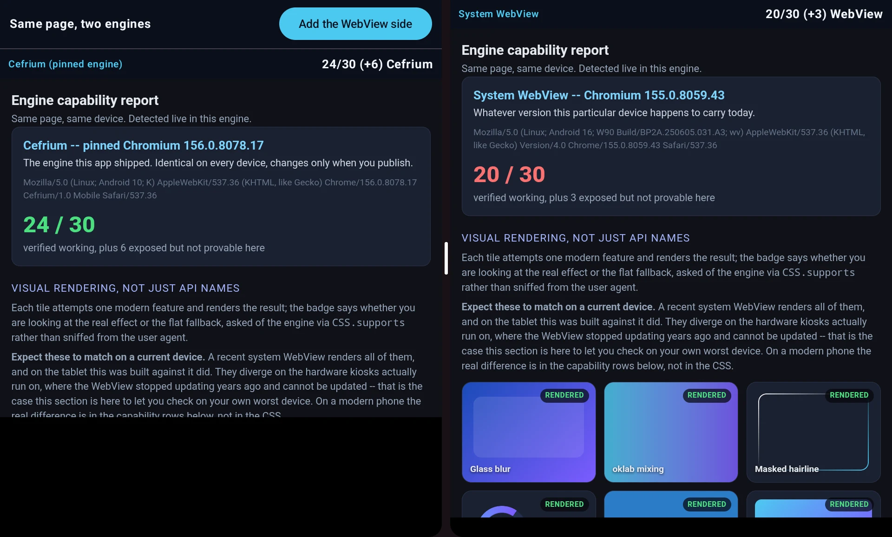
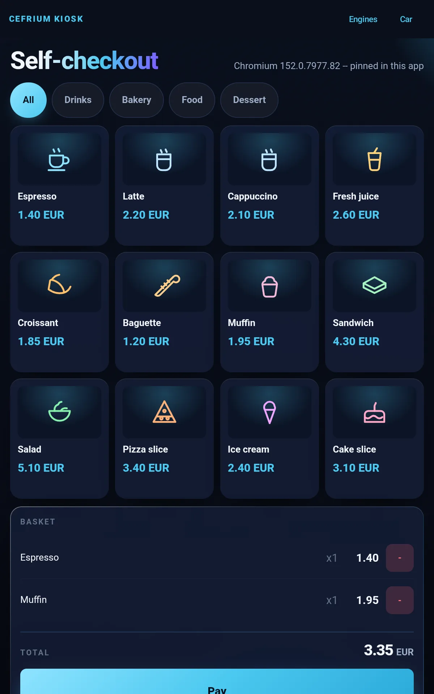
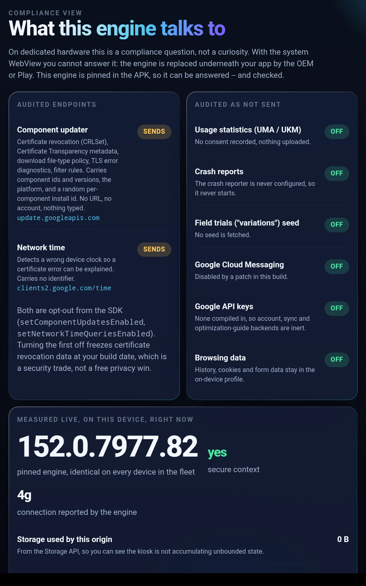
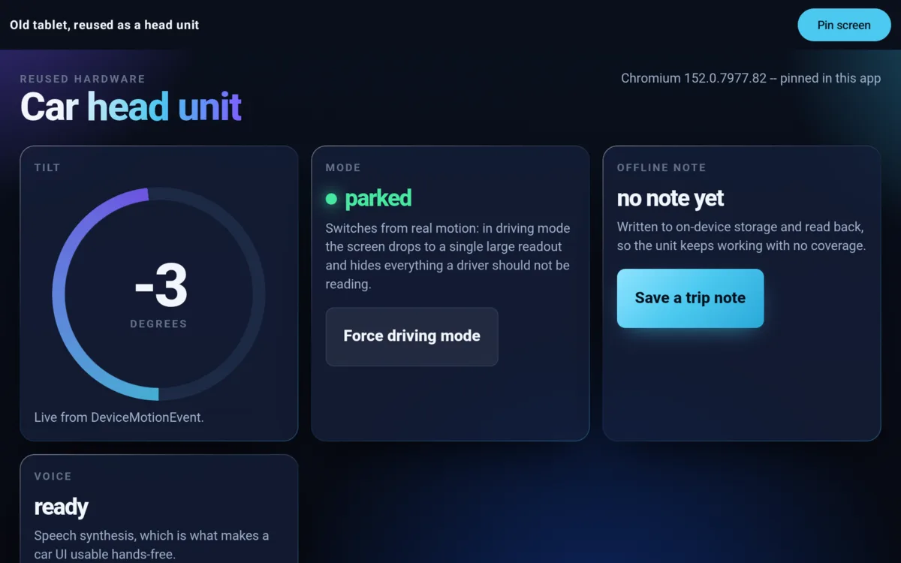

<div align="center">


# Cefrium - CEF for Android

**The full Chromium engine in your Android app, through the CEF C API.**

[](https://codeberg.org/cefrium/cef-android/releases)
[](https://cefrium.com/upstream/)
[](patch/patches/android)
[](https://central.sonatype.com/namespace/com.cefrium)
[](QUICKSTART-CEFRIUM.md)
[](LICENSE-CEFRIUM.md)

[](https://liberapay.com/cefrium/donate)

</div>

The first working port of [Chromium Embedded Framework](https://github.com/chromiumembedded/cef)
to native Android (`aarch64-linux-android`, bionic libc, Android NDK).

CEF officially supports Windows, Linux, and macOS. Android has long been
considered out of scope due to its fundamentally different process model
and UI stack. This project builds on CEF's solid foundation to close
that gap.

### The same page, the same device, two engines

One page that detects what the engine can actually do, rendered by both
engines at once, side by side, in one app on one tablet.



**Cefrium 24 of 30. The system WebView on the same tablet, at the same
moment, 20 of 30** -- and its engine is only one milestone behind, so the
difference is not engine age. It is what the embedder exposes. The three it
misses are Payment Request, WebOTP and the Presentation API: a checkout, an
SMS one-time code, and a customer-facing second screen.

One capture, one device, one instant, no cropping. The report is a live page:
run it on your own device at
[cefrium.com/kiosk](https://cefrium.com/kiosk/) and it will measure whatever
engine you point at it.

> **App size.** Cefrium bundles the Chromium engine, so it adds ~150 MB of native
> code per ABI to your app. The dependency AAR is multi-ABI (~240 MB); publish an
> **Android App Bundle** (or use ABI splits / `ndk.abiFilters`) so each user
> downloads only their architecture (~150 MB), not all ABIs - the same approach
> GeckoView, Flutter, and other engine-bundling SDKs use.

**[Quick Start](QUICKSTART-CEFRIUM.md)** | [API Docs](https://cefrium.com/docs) | [Compose API](https://cefrium.com/docs/compose) | [Migration from WebView](MIGRATION-CEFRIUM.md) | [Build from Source](BUILD-GUIDE-CEFRIUM.md) | [Samples](https://codeberg.org/cefrium/cefrium-sample) | [Sponsor](https://liberapay.com/cefrium/donate)

## What works

The fifteen that decide most evaluations. Full engine first, then the things
Android WebView cannot do at all.

| Capability | Status |
|---|---|
| Full Chromium engine pinned inside your APK (`libcef.so`, arm64 + x86_64) | Done |
| The CEF C API, complete | Done |
| Multi-process: renderers as Android services | Done |
| Off-screen rendering to a pixel buffer (`OnPaint`) | Done |
| Surface rendering with video and audio (H.264/AAC build) | Done |
| Jetpack Compose API (`CefriumView`, state hoisting, tab keep-alive) | Done |
| JS <-> native bridge (`window.cefriumQuery`) and `evaluateJavaScript` | Done |
| Network-level request interception and ad blocking | Done |
| Payment Request / Google Pay | Done |
| WebOTP, SMS one-time-code autofill | Done |
| Web NFC, and barcode detection (QR / EAN / Code128) | Done |
| Web Bluetooth / WebUSB / Web Serial device choosers | Done |
| WebAuthn and passkeys via Android Credential Manager | Done |
| Widevine DRM, Accessibility (TalkBack), Autofill | Done |
| Print to PDF, screen capture, page snapshot to Bitmap | Done |

All 73 capabilities, including the one that is partial and why, are in
[FEATURES-CEFRIUM.md](FEATURES-CEFRIUM.md#capability-status), which then shows
how to use each.

## Why Cefrium, not WebView?

Android WebView runs on whatever Chromium version the device has - which
may be outdated, broken by manufacturer customization, or missing features
your app depends on. Cefrium solves three problems that WebView cannot:

**1. Version consistency.** Cefrium pins to a specific Chromium version
(currently 156). Your web code runs identically on every device, regardless
of the system WebView version. No more "works on Pixel, breaks on Samsung."

**2. Full network control.** WebView's `shouldInterceptRequest` is limited
to URL matching. Cefrium inherits CEF's `CefRequestHandler` which gives
full access to headers, POST bodies, redirects, and response modification --
enabling native ad blocking, request rewriting, and custom protocol handlers
without JavaScript injection.

**3. Off-screen rendering.** Need to render HTML to a pixel buffer for
screenshots, PDF generation, or headless processing? WebView has no API
for this. Cefrium's `OnPaint` delivers RGBA frames to your code - no
Activity, no UI, no Surface required.


*Of the three, this is the only one that is not a matter of degree: a sample
app renders a URL straight to a PNG on disk, which WebView has no API to do
at all.*

| Capability | Cefrium | Android WebView |
|------------|---------|-----------------|
| Chromium version control | Pinned (156) | Varies by device |
| Off-screen rendering (pixel buffer) | Yes (OnPaint) | No |
| Network-level ad blocking | Yes (filter lists, by resource type and page) | By URL only (shouldInterceptRequest) |
| Multi-process control | Yes | No |
| Request headers/body access | Full | URL only |
| Custom protocol handlers | Yes (CefSchemeHandlerFactory) | Partial |
| DRM (Widevine) | Yes | Yes |
| Autofill (password managers) | Yes | Yes |
| Accessibility (TalkBack) | Yes | Yes |
| Web Bluetooth / WebUSB / Web Serial | Yes (CefDeviceChooserHandler) | No |
| WebAuthn / passkeys (web origin) | Yes (Credential Manager) | No |
| Web Share to the system sheet | Yes (navigator.share) | No (needs app glue) |
| Payment Request / Google Pay | Yes (on by default) | Opt-in, recent WebView only |
| Contact Picker (navigator.contacts.select) | Yes (app-drawn) | No |
| File System Access (open/save/directory pickers) | Yes | No |
| WebOTP (SMS one-time-code autofill) | Yes | No |

### What that buys, on real hardware




**Self-checkout and point of sale.** The whole interface is a web app the
engine renders; the Pay button is the platform payment sheet through Payment
Request, which the WebView on the same device did not have. **Compliance.** On
dedicated hardware "what does this engine talk to?" is an audit question, and
it can be answered here because the engine ships inside the APK -- two
endpoints that send, the rest inert, both switchable from the SDK
(`Cefrium.setComponentUpdatesEnabled`, `Cefrium.setNetworkTimeQueriesEnabled`).



**Reused hardware.** An obsolete tablet as a head unit: live tilt from
`DeviceMotionEvent`, a driving mode that strips the screen down, speech
synthesis for hands-free, and notes written to on-device storage so it keeps
working with no coverage. The engine is the same one the fleet was tested
against, because it is pinned in the app rather than updated under it.

These three are screenshots of a running demo, taken on Chromium 152. The
engine has moved on since, and the system WebView's version moves on its own,
per device, which is the point: the comparison at the top of this file was
captured on the current release, and the WebView beside it is whatever that
tablet happened to be carrying that day. The demo and its measurements are at
[cefrium.com/kiosk](https://cefrium.com/kiosk/).

### Shipping this on a fleet?

The three questions a dedicated-hardware project asks before committing to an
engine are answered in writing rather than on request: which Chromium each
release carries and when it moves
([releases](https://cefrium.com/releases/)), what the engine contacts on a
device you cannot inspect (the compliance view above), and what you are allowed
to do with the code (LGPL-3.0-or-later, or commercial terms without those
obligations).

Priority support, a security-response commitment, alternative licence terms and
sponsored engineering are arranged per case:
[cefrium.com/commercial](https://cefrium.com/commercial/), or
**cefrium@proton.me**. Cefrium is pre-1.0 and the public API still moves
between minor releases -- say what you are building and you get a straight
answer about whether it is ready for it, including when it is not.

### What is CEF?

[CEF](https://github.com/chromiumembedded/cef) (Chromium Embedded Framework)
is a BSD-licensed framework maintained by Marshall Greenblatt since 2008.
Over 100 million installed instances power products from Steam, Spotify,
Discord, OBS, and hundreds of other applications across Windows, Linux,
and macOS. Cefrium extends CEF to the one major platform it was missing:
Android.

## Architecture

- **Off-screen rendering** via `CefRenderHandler::OnPaint` - no Views
  framework, no X11, no Wayland
- **Multi-process** with renderer running as an Android `Service`,
  replacing Unix `fork()`/`execve()`
- **42 Android-specific Chromium patches** for Android adaptations, managed via
  CEF's existing patch infrastructure (`cef/patch/patches/android/`)
- **Gradle Plugin** generates R.java for Chromium packages in consumer
  projects, solving the multi-package resource ID problem

## Sources

Cefrium is built from three deliberately-tracked source inputs:

- **Chromium** - upstream Google source,
  `https://chromium.googlesource.com/chromium/src.git`, via depot_tools/gclient.
  Pinned (in `.gclient`) to the **exact tag Debian packages**
  (`apt-cache policy chromium`; currently `156.0.8078.17`) for **CVE parity** - we
  inherit the security fixes in that upstream release. The bytes are **vanilla
  upstream**, not Debian's patched source: we use Chromium's bundled deps + the
  Android NDK toolchain, *not* Debian's system libraries. (The sibling
  [Debian CEF package](https://salsa.debian.org/mendezr/chromium-embedded-framework),
  same maintainer, takes the other path - Debian's Chromium tarball + Debian
  patches via Multiple Upstream Tarballs, system `gn`/`ninja`, no depot_tools.)
- **CEF** - `cef/`, the `android-port` branch forked from the upstream CEF branch
  that matches Chromium's build number, the 3rd version component:
  Chromium 156 -> branch 8078 (see `cef/CHROMIUM_BUILD_COMPATIBILITY.txt`). Hosted at
  [codeberg.org/cefrium/cef-android](https://codeberg.org/cefrium/cef-android).
- **Patches** - applied to the Chromium tree by `cef/cefrium_sdk/apply-patches.py`
  (a patcher.py wrapper that activates the android condition): CEF's own
  Chromium patches plus **42 Android-specific** patches
  (`cef/patch/patches/android/`, all registered in `patch/patch.cfg`). **No Debian
  Chromium patches** - only CEF + Android adaptations.

Engine-version tracking and how to upgrade it (e.g. 148 -> 149) are in
[`RELEASING-CEFRIUM.md`](RELEASING-CEFRIUM.md) (the "Engine bump" section); the upgrade is run via
`cef/cefrium_sdk/engine-bump.sh`.

## Building from source

Prerequisites: a Chromium source tree at the pinned tag (see **Sources** above --
currently `156.0.8078.17`), ~400 GB disk, 64 GB RAM.

```bash
cd chromium/src
python3 cef/cefrium_sdk/apply-patches.py                     # never patcher.py directly
depot_tools/gn gen out/Official_android_arm64 --args='target_os="android" target_cpu="arm64" is_official_build=true is_component_build=false'
ninja -C out/Official_android_arm64 cef/cefrium_sdk:cefrium_sdk
```

The full GN argument list, the libre variant, the test APK and the device run
are in **[BUILD-GUIDE-CEFRIUM.md](BUILD-GUIDE-CEFRIUM.md)**. Before adding or
regenerating a Chromium patch read **[PATCHING-CEFRIUM.md](PATCHING-CEFRIUM.md)**:
the storage format (`-p0`, no `a/`/`b/` prefix), `patch.cfg` registration and
one-file-one-patch ownership are strict, and a clean `apply-patches.py` must
report `0 failed`.

## SDK releases

Pre-built AARs are published on
**[Codeberg Packages](https://codeberg.org/cefrium/-/packages)**
(Maven registry). No need to build from source.

### Gradle integration

Published to **Maven Central** (recommended -- `mavenCentral()` resolves it with
no extra repository line, and every version stays available permanently) and
mirrored on the **Codeberg Maven registry**, which serves the latest version
only. For the mirror, add
`maven { url 'https://codeberg.org/api/packages/cefrium/maven' }` to both
`pluginManagement` and `dependencyResolutionManagement` in `settings.gradle`.

```groovy
// app/build.gradle
plugins {
    id 'com.android.application'
    id 'com.cefrium' version '0.16.0'  // generates R.java for Chromium packages
}

dependencies {
    implementation 'com.cefrium:cefrium-sdk:0.16.0'      // multi-ABI; your APK ships one
    implementation 'com.cefrium:cefrium-compose:0.16.0'  // optional, Jetpack Compose
    implementation 'androidx.appcompat:appcompat:1.7.0'
    implementation 'androidx.mediarouter:mediarouter:1.7.0'
    implementation 'androidx.core:core:1.16.0'
    implementation 'androidx.browser:browser:1.8.0'
}
```

The Application class, the manifest entries and the first Activity are set out
step by step in **[QUICKSTART-CEFRIUM.md](QUICKSTART-CEFRIUM.md)**, which also
covers app size, ABI splits, ProGuard/R8 and the build errors that come up most.

### Direct download

Alternatively, download the AAR directly from
[Codeberg Packages](https://codeberg.org/cefrium/-/packages):

**SDK (multi-ABI: arm64-v8a + x86_64, H.264/AAC + VP8/VP9/Opus):**
- [cefrium-sdk-0.16.0.aar](https://codeberg.org/api/packages/cefrium/maven/com/cefrium/cefrium-sdk/0.16.0/cefrium-sdk-0.16.0.aar) (~250 MB, `arm64-v8a` + `x86_64`; the consumer's APK/App Bundle ships only the device's ABI, ~150 MB)

**Jetpack Compose wrapper (all architectures):**
- [cefrium-compose-0.16.0.aar](https://codeberg.org/api/packages/cefrium/maven/com/cefrium/cefrium-compose/0.16.0/cefrium-compose-0.16.0.aar) (28 KB)

Place in `app/libs/` and use `implementation files('libs/cefrium-sdk.aar')`.

### Variants

Each artifact is a single **multi-ABI** AAR (arm64-v8a + x86_64; only the device's
ABI is shipped per APK/App Bundle). They differ only by codec policy:

| Artifact | Codecs | Use case |
|----------|--------|----------|
| `cefrium-sdk` | H.264, H.265, AAC, VP8, VP9, Opus | Full site compatibility (published) |
| `cefrium-sdk-libre` | VP8, VP9, Opus, Vorbis | Royalty-free only (planned) |

**Patent note:** H.264 patents expire by [November 2027](https://www.osnews.com/story/24954/us-patent-expiration-for-mp3-mpeg-2-h264/)
(last US patent: [US 7826532](https://patents.google.com/patent/US7826532B2), expires 2027-11-29).
In the EU, software "as such" is excluded from patentability
([EPC Art. 52](https://en.wikipedia.org/wiki/Software_patents_under_the_European_Patent_Convention)).

See [cefrium-sample](https://codeberg.org/cefrium/cefrium-sample) for
complete working examples.

### Cutting a release (maintainers)

One command: `cef/cefrium_sdk/cut-release.sh <version> <prev>`. What each phase
does, and the facts that bite, are in
**[RELEASING-CEFRIUM.md](RELEASING-CEFRIUM.md)**.

## Project structure

```
cef/
|-- libcef/browser/android/        # Android browser implementation
|-- cefrium_sdk/                   # AAR packaging (BUILD.gn, slim_aar.py)
|   |-- gradle-plugin/             # Gradle Plugin for R class generation
|   `-- java/src/com/cefrium/      # Java API
|-- cefrium_compose/               # Jetpack Compose wrapper (cefrium-compose.aar)
|-- cefrium_instrumentation_test/  # On-device instrumented test harness (SDK + Compose)
|-- tests/cef_android_test/        # Test APK
`-- patch/patches/android/         # 42 Android-specific Chromium patches
```

## Testing

The authoritative on-device suite is `cefrium_instrumentation_test/`, a
self-contained Gradle module (not part of the GN/ninja build) that consumes the
built AARs and exercises the public SDK exactly as a consumer would, so a clone
of this repo is self-verifying, independent of the samples repo: **48 test
classes, 160 `@Test` methods** across the Java SDK (core, hardening, the
`window.cefriumQuery` JS bridge, navigation, cookies, settings, the request
interceptor, permissions, PDF, media, popups, JS dialogs, nested scroll, SSL
and HTTP auth) and the Compose API (`CefriumView` tab keep-alive,
`CefriumNavigator` evaluateJavaScript -> `onQuery`). When a feature ships, its
test joins this suite, so it gates releases.

```bash
cd cefrium_instrumentation_test
cp ../../out/<dir>/cefrium-sdk.aar app/libs/                 # stage the AAR under test
cp ../cefrium_compose/build/outputs/aar/cefrium-compose-release.aar app/libs/cefrium-compose.aar
./gradlew connectedDebugAndroidTest --no-daemon              # whole suite on a connected device
```

The full coverage table is in
[`cefrium_instrumentation_test/README.md`](cefrium_instrumentation_test/README.md),
and the registry-only consumer smoke test that gates each release is in
[RELEASING-CEFRIUM.md](RELEASING-CEFRIUM.md). The
[cefrium-sample](https://codeberg.org/cefrium/cefrium-sample) repo runs a
Woodpecker CI that builds every sample and compiles the test APK on each push.

## Relationship to upstream CEF

Fork of CEF branch 8078, tracking Chromium 156.0.8078.17.
Branch `android-port` contains all Android changes.

Upstream CEF's own README is kept verbatim in
[README-CEF.md](README-CEF.md). It describes CEF on Windows, Linux and macOS
and says nothing about Android; its donation link goes to upstream CEF, not to
Cefrium. What this port adds, and what it deliberately keeps downstream, is set
out at [cefrium.com/upstream](https://cefrium.com/upstream/).

### Contributing upstream

All Android changes are isolated and reviewable:

- **CEF changes** (`libcef/browser/android/`, `cefrium_sdk/`): on the
  `android-port` branch. Generate patches with:
  ```bash
  git format-patch origin/8078..android-port -- \
    ':!README.md' ':!assets/screenshots'
  ```
- **Chromium patches** (`patch/patches/android/`): 42 Android-specific patches
  applied via `apply-patches.py` (CEF's `patcher.py`, `-p0`). Each addresses a
  specific incompatibility between Chromium's assumptions and the Android
  embedding environment. Format, registration and regeneration are documented in
  **[PATCHING-CEFRIUM.md](PATCHING-CEFRIUM.md)**; a clean reapply must report `0 failed`.
- **Build changes** (`BUILD.gn`): Android-specific sources, deps, and
  `embedder_support` integration.

If you have expertise in CEF or Chromium internals and want to help
bring this upstream, open an issue or email cefrium@proton.me.

## Platform integration status

Cefrium is NOT a drop-in WebView replacement: it bundles its own Chromium and
provides capabilities WebView doesn't have (off-screen rendering, request
interception with full URL access, pinned Chromium version). The Android
platform integrations it wires up:

| Feature | Status |
|---------|--------|
| Android Accessibility (TalkBack) | Done |
| Autofill framework (password managers) | Done |
| Widevine DRM (Netflix, Disney+, Spotify) | Done |
| Web permissions (geolocation, camera, microphone) | Done - routed to your `PermissionHandler` |
| WebAuthn / Passkeys | Limited - requires Google Play Services browser verification (same constraint as Brave/Firefox). SDK apps can use APP mode + Digital Asset Links for specific domains. |
| System media controls (lock-screen MediaSession) | Done - `setMediaSessionEnabled(true)` (ships a foreground service; needs POST_NOTIFICATIONS) |
| Web Notifications (system notification shade) | Done - service-worker `showNotification()` posts to the Android shade; permission via `PermissionHandler` (or pre-grant with `setContentSetting`); needs `androidx.browser` + `POST_NOTIFICATIONS` |
| Web Push (PushManager / push subscriptions) | API exposed; full FCM registration needs a consumer Firebase project (`google-services.json`) - see docs |

Surface rendering uses `ContentViewRenderView` - the same Chromium
component as Chrome Android. No additional overhead vs Chrome.

**Picture-in-Picture.** Web video PiP (`video.requestPictureInPicture()`) is
available. Whole-app (Activity) PiP is owned by your Activity: set
`android:supportsPictureInPicture="true"` and call `enterPictureInPictureMode()`
-- a good trigger is `setOnFullscreenChangedListener` (enter PiP when a video goes
fullscreen).

## About

Cefrium is in early validation.

### Maturity and risks

**What Cefrium gives you:** A complete Chromium engine under your control,
with the same CEF API that powers Steam, Spotify, and Discord - now on
Android. Every commit is tested on real devices. All 42 Chromium patches
are auditable in `patch/patches/android/`.

**What you should know:**
- **APK size:** ~150 MB per architecture (comparable to Chrome itself; the
  multi-ABI AAR is ~240 MB but each device ships only one ABI).
  Use R8/ProGuard, ABI splits, and AAB format to optimize delivery -- see
  [QUICKSTART-CEFRIUM.md](QUICKSTART-CEFRIUM.md#proguard-r8-and-apk-size).
- **Security updates:** Cefrium tracks Debian Chromium releases for
  CVE patches. Currently pinned to 156.0.8078.17.
- **Not a WebView replacement:** Cefrium bundles its own Chromium.
  It does not reuse the system WebView. This is by design - it's what
  gives you version control and full API access.

### Contributing

If you work with CEF, Chromium internals, or native Android development
and are interested in co-maintaining: cefrium@proton.me

Published as open source (LGPL-3.0) for the community to evaluate,
use, and extend.

## Supporting Cefrium

Cefrium is maintained by one person. What recurring donations pay for is the
part nobody sees: every Chromium release moves the ground under the 42
Android-specific patches this port carries, and each one has to be
re-validated, regenerated where it conflicts, and re-tested on real devices
before an engine bump can ship. That work is what keeps a pinned engine
current with upstream security fixes instead of frozen at whatever it shipped
with.

[](https://liberapay.com/cefrium/donate)

If you are shipping a product on Cefrium, a support or licence arrangement
funds the same work at a scale donations cannot, and gives you a commitment in
return rather than goodwill:
[cefrium.com/commercial](https://cefrium.com/commercial/),
**cefrium@proton.me**.

## License

The **Cefrium SDK** (`cefrium_sdk/`, its JNI bridge, the Compose wrapper,
UnifiedPush, the relay and the Gradle plugin) is **dual-licensed - choose one:**

- **[LGPL-3.0-or-later](https://www.gnu.org/licenses/lgpl-3.0.html)** - free/libre.
  Use it in any app, closed source included: keep the notices, say where the
  source of the release is, keep `libcef.so` as its own file and the SDK's
  ProGuard rules as they are, and do not forbid reverse engineering of the
  library. Hardware you sell with the app installed also needs the
  installation information LGPLv3 asks for. Details:
  [cefrium.com/policy](https://cefrium.com/policy/).
- **Cefrium Commercial License** - for closed-source / proprietary integration
  without LGPL obligations. Contact: **cefrium@proton.me**

The underlying **CEF and Chromium** code is **BSD** (inherited upstream) and is
unaffected by the above. So is the Android platform code and the Chromium
patches this port adds: they stay under CEF's BSD license because they are
meant to go upstream. `REUSE.toml` says which license covers each file.

### Attribution

To meet the notice requirement, put this text where your app lists its
open-source licenses, and ship the NOTICE file from the release you use:

```
This app uses Cefrium (https://cefrium.com), licensed under the GNU Lesser
General Public License v3.0 or later
(https://www.gnu.org/licenses/lgpl-3.0.html). Cefrium includes CEF and
Chromium, licensed under the BSD 3-Clause license. Their third-party notices
are in the NOTICE file published with each Cefrium release. Source:
https://codeberg.org/cefrium/cef-android/src/tag/vX.Y.Z
```

Put the version you ship in place of `X.Y.Z`.

If you modified the Cefrium library itself, also make the source of that
modified library available under the same license. Details and questions:
[cefrium.com/policy](https://cefrium.com/policy/#attribution).

None of this requires crediting Cefrium visibly in your app. If you want to, a
mention or a link back is always appreciated, but it is entirely optional.
